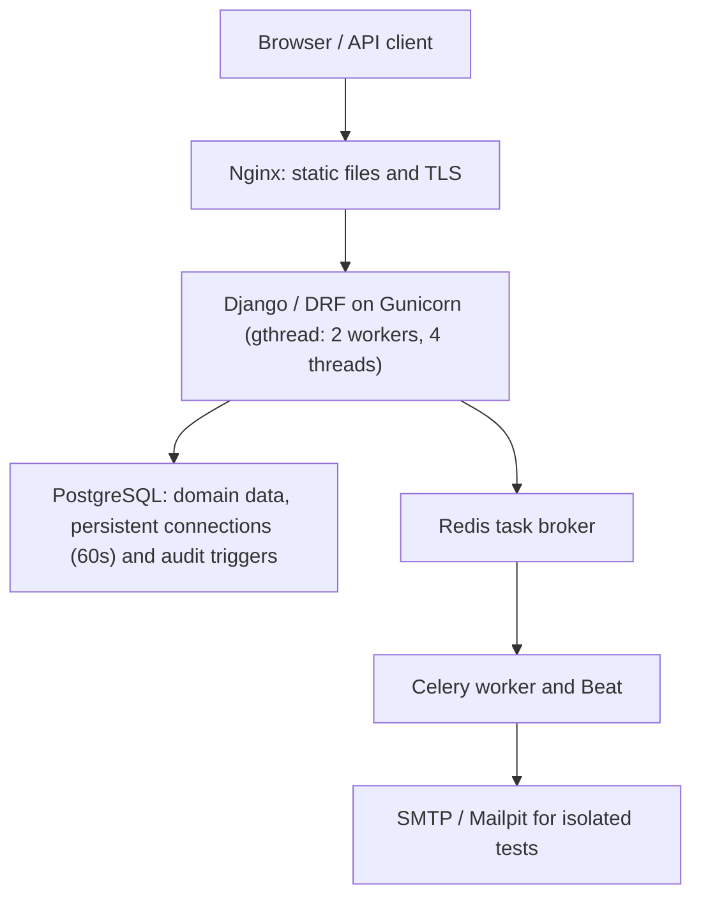

# Student Attendance Management System (SAMS)

Final project report · review edition · 3 November 2026  
UE24CS341A Software Engineering · PES University · AIML Section F

## Team and accountability

| Member | SRN | GitHub | Role |
| --- | --- | --- | --- |
| Kundhan Vudutha | PES1UG24AM327 | Kundhan73 | Developer: implementation, integration, fixes and delivery |
| Tarun J | PES1UG24AM304 | DarkTJ7 | Tester: execution, defects and retests |
| Anish | PES1UG24AM348 | planetai05 | QA: requirements, evidence, traceability and release review |

Repository: https://github.com/Kundhan73/SE-MiniProject-SAMS  
Project: https://github.com/users/Kundhan73/projects/1  

These are accountable roles. Git history and evidence identify actual contributions, including fixes and tests submitted in teammate PRs. Assisted execution is identified in its reports. A task assignment or automated pass does not establish personal review, faculty approval or UAT.

## Problem and scope

SAMS replaces fragmented attendance records with scheduled faculty roll calls, private student views, correction decisions and auditable reports. It implements the submitted Django/DRF architecture as a modular monolith. The local demo uses synthetic identities; it is not a production deployment with real student records.

The baseline SRS defines 21 functional, six non-functional and five security requirements. The complete mapping from requirement to code and automated evidence is in [TRACEABILITY.md](TRACEABILITY.md). Tests support the implemented behaviors; external, human and long-term acceptance remains separately tracked.

## Schedule and evidence dates

| Teacher window | Status as of 2 November |
| --- | --- |
| Sprint 1: 19–23 October | Baseline planning window. The current build and one-minute retrospective were produced later; no original sprint delivery is inferred. |
| Sprint 2: 26–30 October | Implementation, test evidence, bug fixes and integration prepared. Merged into `main` via PR #1 (`c9e305f`) by repo owner Kundhan73. |
| Testing / Sprint 3: 2–6 November | Active validation, performance tuning, and closeout window. PR #54 submitted by DarkTJ7 addressing 300-client scale latency; reviewed and APPROVED by QA Engineer Anish (@planetai05). |

Earlier Jira sprint dates differ from the teacher's windows. [DEVIATIONS.md](DEVIATIONS.md) explains this and the technical changes. GitHub and Jira are reconciled from reviewed evidence at the owner's request. Board status follows reviewed evidence, not a claimed historical sprint completion.

## Architecture

Domain modules are accounts, courses, attendance, reports, notifications and audit. Shared API adapters, permissions and input errors live in core. Diagram sources, revised SRS/SAD/Test Plan PDFs and API documentation are under docs. [API.md](API.md) describes endpoints; the same-origin Swagger UI is available at /api/docs/.

## Implemented behavior

| Area | Behavior and boundaries |
| --- | --- |
| Accounts | Institute-ID authentication, salted production password hashing, five-failure lockout, expiring single-use reset links, idle expiry and logout revocation. |
| Access | Student, Faculty and Admin permissions and record ownership enforced on the server. Project team roles are separate from application roles. |
| Academic setup | Courses, sections, faculty assignment, timetable clash checks and CSV enrollment with row errors. |
| Attendance | Timetable-derived sessions, complete P/A/OD rosters, atomic submission, duplicate rejection and explicit edits with reasons. Submitted views use actual saved marks. |
| Corrections | Student requests routed to responsible faculty; approve/reject decisions and resulting record changes are audited. |
| Reports | Student/course/date filters, strictly-below-threshold defaulters, CSV formula neutralization and paginated PDF export. No held classes is displayed as No classes. |
| Notifications | In-app records, background email, daily deduplication, retry exhaustion and admin-only failure inspection. |
| Audit | Append-only service/API behavior plus SQLite/PostgreSQL triggers rejecting direct mutation. Database-owner privileges remain an operational responsibility. |
| UI | Role dashboards, distinct form labels, focusable named table regions, keyboard scrolling and CSP-compatible local API documentation assets. |
| Operations | Database/Redis health checks, Gunicorn concurrency tuning, connection reuse, image delivery and a working-hours probe utility. Installation of external monitoring and scheduled backups is still required. |

## Test strategy and current reports

The automated suite includes service, API/database, monitoring, and workflow checks. SQLite and PostgreSQL are tested in CI. Statement coverage must reach 80% and branch coverage 70%; the report generator enforces both gates.

The current integrated execution counts and percentages are generated from actual XML:

- [Unit and integration report](reports/Unit_Test_Report.md)
- [System Validation Report](reports/System_Validation_Report.md)
- [Code Coverage Report](reports/Code_Coverage_Report.md)
- [Branch Coverage Report](reports/Branch_Coverage_Report.md)
- Raw [JUnit](reports/junit.xml), [coverage XML](reports/coverage.xml) and [summary](reports/summary.json)

Current test results: **166 passed**, 0 failures/errors, **100.0% statement coverage** (764/764), and **98.24% branch coverage** (167/170). Monitoring coverage is measured separately; see `reports/monitor-coverage.json`.

### Independent and assisted evidence

- [Tarun's 29 October report](testing/tarun-2026-10-29/README.md) retains original failures, integrated retests, local Docker/PostgreSQL/Mailpit results, retry/recovery and initial accessibility/security checks.
- [His 30 October report](testing/tarun-2026-10-30/README.md) and case register record 33 targeted authenticated HTTP checks, bounded ZAP scan, nine localhost TLS checks with an explicit private CA, and 49 browser/accessibility cases with six Lighthouse snapshots at 100.
- [His 2 November report](testing/tarun-2026-11-02/README.md) records the full 2 November acceptance retest (60 functional, 33 security, 12 auth boundary, 49 browser cases) and the resolution of the 300-user performance bottleneck in PR #54.

The supplied reports identify tool-assisted execution. Tarun's personal conclusion, Anish's QA reviews, and faculty UAT remain distinct. Physical-device and human assistive-technology checks are not established by browser emulation alone.

### Performance evidence and capacity resolution

| Candidate / Profile | Actual commit | Requests | Failures | p95 ms | Full-client seconds | Result |
| --- | --- | --- | --- | --- | --- | --- |
| Baseline 05ce028 (perf100) | 05ce028 | 34,320 | 0 | 150.0 | 600.00 | PASS |
| Baseline 05ce028 (perf300) | 05ce028 | 35,701 | 0 | 3,100.0 | 120.00 | BOTTLENECK |
| Merged main (perf100) | c9e305f | 33,719 | 0 | 220.0 | 600.02 | PASS |
| Merged main (perf300) | c9e305f | 31,211 | 0 | 3,800.0 | 120.06 | BOTTLENECK |
| **PR #54 candidate (perf100)** | b60f42b | 35,018 | 0 | **20.0** | 600.03 | **PASS** |
| **PR #54 candidate (perf300)** | b60f42b | 62,968 | 0 | **60.0** | 120.04 | **PASS** |

The PR #54 candidate resolved the queueing bottleneck by adding four `gthread` request threads per worker (two Gunicorn processes) and reusing healthy PostgreSQL connections for up to 60 seconds (`CONN_MAX_AGE=60`), staying strictly within the two-process and <4 GiB memory budget. At 300 concurrent clients, p95 latency dropped from 3,800 ms to 60 ms with 0 failures, well within the < 3,000 ms budget (SAMS-NF-001).

The final candidate has one complete recorded run. Aggregate latency includes ramp/login traffic. The 300-client profile reuses 100 faculty identities and makes no new attendance submissions; it is not a 300-user simultaneous-write claim. The 100-client profile includes 40 full-roster submissions. Actual deployment capacity must be revalidated.

## Defects and integration

| Finding | Change |
| --- | --- |
| #45 | Format a missing PDF percentage as No classes; retain the percent suffix for numeric values. |
| #46 | Separate current backend execution from supplied browser/load artifacts and disclose missing provenance. |
| #47 | Give repeated admin selectors distinct IDs while preserving submitted field names. |
| #49 | Add consistent proxy security headers and remove incompatible inline progress-bar attributes. |
| #51 | Make overflow tables named, keyboard-focusable scrolling regions. |
| #52 | Serve Swagger assets locally and use external initialization under strict CSP. |
| Database health outage | Return a clear 503 when the database probe fails. |
| Integration monitoring review | Avoid passing an unmeasured SLA, validate the health response, preserve corrupt history and support repeated recorded probes. |
| Scale latency bottleneck | Overlap I/O with Gunicorn `gthread` threads (4/worker) and reuse healthy PostgreSQL connections (60s). |
| Monitor test coverage | Add test coverage for error responses, network failures, non-list history and CLI modes (96.20% coverage). |

Original failures and historical retests are preserved.

## CI/CD and release process

Every PR runs SQLite and PostgreSQL tests, lint/format and migration checks, dependency audit, browser workflows, Docker build/smoke test and target-scale load check.

PR #1 was reviewed and merged to `main` at `c9e305f`. Delivery built and published the SHA-tagged container image and latest to GHCR. PR #54 was reviewed and APPROVED by QA Engineer Anish (@planetai05).

Actual Jenkins/Sonar execution is retained in [the 3 November record](testing/jenkins-2026-11-03/README.md): 166 tests, successful Docker build, and a measured Sonar coverage condition of 99.7% against 80%. The coverage-path regression preserves distinct modules; the strict latency gate rejects exactly 3,000 ms. The latest main CI and Delivery identify the final published revision.

## Maintenance and monitoring

[MAINTENANCE_PLAN.md](MAINTENANCE_PLAN.md) contains backup, restore, connection sizing, and explicit-image rollback procedures. The operator must install and rehearse scheduling, encrypted storage, offsite transfer and recovery on a selected host. The RTO of two hours and RPO of 24 hours are objectives. Image rollback can involve downtime and cannot undo incompatible database changes.

The probe utility (`scripts/monitor_uptime.py`) supports repeated recording, single checks, and working-hours summary calculations. Missing observation intervals are not automatically counted as uptime.

## Remaining acceptance and submission work

- Provision a staging host/domain and test email service for public TLS/external delivery checks, or obtain an explicit faculty decision on unavailable resources.
- Obtain Tarun's personal review and conclusion under DarkTJ7; complete human/device checks required by the course.
- This revision includes QA/developer closeout PR #56; verify the latest main CI and delivery before presenting.
- Rehearse backup/restore/rollback and collect real monitoring/retention evidence over the required time period.
- Complete the 15-minute live demonstration, oral defense, and faculty evaluation sign-off.

## Sign-off status

- PR #1 Developer Integration: **MERGED** (`c9e305f`)
- PR #54 QA Code Review & Architecture Verification: **APPROVED** by Anish (@planetai05)
- Tester Personal Acceptance: **PENDING** under DarkTJ7
- Faculty UAT & Evaluation Sign-Off: **PENDING** (scheduled for defense window)
