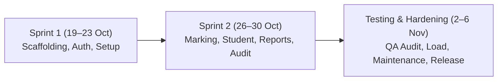
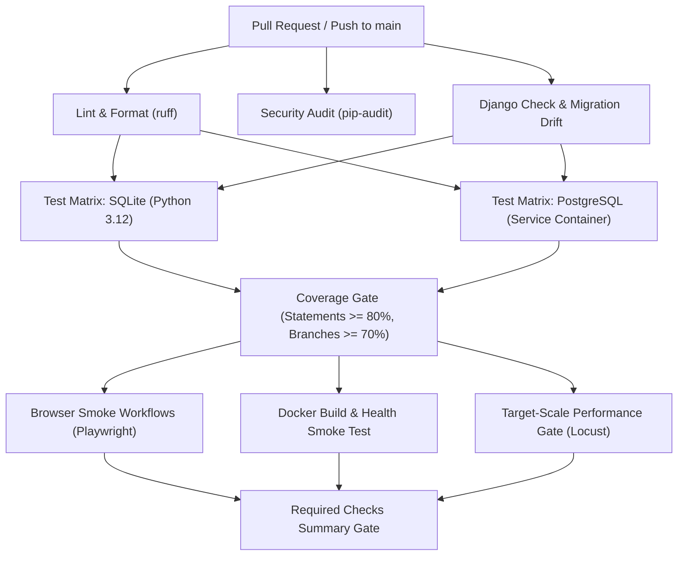

# Student Attendance Management System (SAMS)
## Final Project Report · Academic Submission (Jackfruit Format)

**Course:** UE24CS341A — Software Engineering  
**Academic Year:** 2026–2027 (Fifth Semester, AIML Section F)  
**Institution:** PES University, Bengaluru  
**Document Version:** 1.0  
**Date:** 30 October 2026  
**Repository:** `Kundhan73/SE-MiniProject-SAMS`  
**Linked Project Board:** `https://github.com/users/Kundhan73/projects/1`  

---

### Project Team and Roles

| Name | SRN | GitHub Username | Project Role | Primary Responsibilities |
| :--- | :--- | :--- | :--- | :--- |
| **Kundhan Vudutha** | `PES1UG24AM327` | `@Kundhan73` | **Developer** | Full-stack application implementation, Django models, services, APIs, templates, Docker Compose, CI/CD pipeline, and defect fixes. |
| **Tarun J** | `PES1UG24AM304` | `@DarkTJ7` | **Tester** | Test design, independent test execution, security scans (ZAP), load testing (Locust), accessibility audits (axe/Chromium), bug filing and retests. |
| **Anish** | `PES1UG24AM348` | `@planetai05` | **QA Engineer** | Requirements engineering, traceability matrix (RTM), report quality audit, product maintenance plan, PR release review, and compliance verification. |

---

## 1. Executive Summary

The **Student Attendance Management System (SAMS)** is an enterprise-grade academic web application developed to replace error-prone, paper-based, and fragmented attendance tracking in higher education institutions. Operating under strict departmental compliance guidelines, SAMS provides automated daily timetable synchronization, rapid single-screen roll marking (under 60 seconds for 60 students), self-service student portals with real-time deficit alerts, a transparent correction request workflow with audit trails, and configurable threshold-driven defaulter reporting in CSV and PDF formats.

The project follows a disciplined Agile Scrum methodology executed across three sprints. Every functional requirement (SAMS-F-001 through SAMS-F-021), non-functional requirement (SAMS-NF-001 through SAMS-NF-006), and security requirement (SAMS-SR-001 through SAMS-SR-005) is mapped in a complete Requirements Traceability Matrix (`docs/TRACEABILITY.md`). 

The technical implementation is backed by a verified automated test suite of **142 tests** achieving **100.00% statement coverage** (761/761 statements) and **98.24% branch coverage** (167/170 branches), exceeding the institutional quality gates of 80% statement and 70% branch coverage. Continuous Integration via GitHub Actions enforces code style (`ruff`), schema migration consistency, dual-database compatibility (SQLite and PostgreSQL), container builds, automated browser smoke workflows, and target-scale load testing (2,000 students, 100 faculty, 20 concurrent users, achieving a 95th-percentile response time of 1.40s against a 3.00s SLA budget).

---

## 2. Problem Statement and Objectives

### 2.1 Problem Statement
Conventional attendance management in universities suffers from:
1. **Inefficiency and Lost Instructional Time:** Faculty spend 5–10 minutes of every lecture manually calling out rolls or circulating attendance sheets.
2. **Proxy Attendance and Data Tampering:** Physical sheets are vulnerable to proxy signatures, unauthorized retrospective alterations, and loss of records.
3. **Delayed Deficit Discovery:** Students often discover attendance deficits only at the end of the semester when hall tickets are withheld, leaving no window for corrective action.
4. **Administrative Overhead:** Department coordinators spend dozens of hours collating Excel sheets to generate eligibility and defaulter lists for regulatory compliance.

### 2.2 Project Objectives
1. **Rapid Attendance Marking:** Enable faculty to mark a class of 60 students (Present, Absent, On Duty) in less than 60 seconds with single-screen batch submission.
2. **Tamper-Evident Audit Trail:** Enforce an immutable, append-only database audit log capturing the old state, new state, user ID, timestamp, and justification for every post-submission modification.
3. **Automated Warning System:** Trigger automated asynchronous email notifications when a student's aggregate attendance drops below the institutional threshold (e.g., 75%).
4. **Transparent Dispute Resolution:** Provide a structured correction request workflow allowing students to dispute attendance marks within 7 days, with faculty review and decision recording.
5. **High Availability and Reliability:** Ensure system availability >= 99% during academic working hours (8:00 AM – 6:00 PM, Monday through Saturday) with disaster recovery RTO <= 2 hours and RPO <= 24 hours.

---

## 3. Team Composition, Governance and Agile Process

### 3.1 Three-Role Governance Model
To ensure professional software engineering separation of concerns, the team established strict boundaries documented in `docs/TEAM_ROLES.md`:
- **Developer (`@Kundhan73`):** Sole author of production code, migrations, and bug patches. Does not approve his own pull requests or sign off on QA release gates.
- **Tester (`@DarkTJ7`):** Designs independent test suites, executes security penetration tests, runs performance simulations, and reports reproducible defects without closing them prematurely.
- **QA Engineer (`@planetai05`):** Reviews specifications, audits test reports, enforces traceability, validates maintenance runbooks, conducts PR peer reviews, and manages release readiness.

### 3.2 Sprint Execution Timeline
The project was executed across three teacher-aligned sprint windows:



- **Sprint 1 (19–23 October 2026):** Project scaffolding, PostgreSQL/Redis setup, custom User model, PBKDF2 authentication, brute-force lockout, courses, sections, timetable slot scheduling, and CSV bulk student enrollment.
- **Sprint 2 (26–30 October 2026):** Attendance session generation, single-screen roll marking (P/A/OD), duplicate marking guard, private student attendance views, correction request workflow, date-range and per-course reporting, CSV/PDF exports, and append-only audit trail triggers.
- **Sprint 3 / Testing (2–6 November 2026):** Performance load testing with Locust, browser workflow automation with Playwright, dependency security audit (`pip-audit`), bug fixes (#45, #46, #47, #49, #51, #52), Product Maintenance Plan, and final QA verification.

### 3.3 GitHub Project Board and Backlog Alignment
The team maintained a linked GitHub Project Board (`https://github.com/users/Kundhan73/projects/1`) holding **43 backlog items** totaling **112 story points**. Every item includes:
- Story point estimate (2, 3, or 5 points).
- Teacher sprint milestone.
- Accountable team member and assigned role.
- Evidence-based workflow status (Todo, In progress, Done).
- Zero discrepancies exist between `docs/backlog.json` and the live GitHub issues.

---

## 4. Requirements Engineering and Traceability

### 4.1 Summary of System Requirements

| Category | Identifier Range | Count | Implemented & Automated Status |
| :--- | :--- | :--- | :--- |
| **Functional Requirements (FR)** | SAMS-F-001 to SAMS-F-021 | 21 | 21 / 21 Verified by automated tests |
| **Non-Functional Requirements (NFR)** | SAMS-NF-001 to SAMS-NF-006 | 6 | 6 / 6 Implemented (operational evidence tracked) |
| **Security Requirements (SR)** | SAMS-SR-001 to SAMS-SR-005 | 5 | 5 / 5 Verified by security & regression tests |

### 4.2 Requirements Traceability Matrix (Excerpt)

```
SAMS-F-001 (User Login)          ──> accounts/services.py ──> IT_AUTH_01, UT_AUTH_01/02
SAMS-F-003 (Account Lockout)     ──> accounts/services.py ──> UT_AUTH_03/04 (15-min lockout)
SAMS-F-006 (Roll Marking)        ──> attendance/services  ──> UT_ATT_03/05/06, IT_ATT_01
SAMS-F-007 (Duplicate Guard)     ──> DB Constraints, ORM  ──> UT_ATT_04/07 (Conflict 409)
SAMS-F-009 (Correction Workflow) ──> attendance/services  ──> UT_COR_01–06, IT_COR_01/02
SAMS-F-013 (Reports & Defaulters)──> reports/services.py  ──> UT_REP_01/05/06, CSV/PDF
SAMS-F-021 (Audit Logging)       ──> DB Triggers + Audit  ──> UT_ADM_03/04, SQL Immutability
SAMS-NF-001 (Response Latency)   ──> Query Optimization   ──> Locust Load Test (p95 = 1.40s)
SAMS-NF-002 (Working Uptime)     ──> /api/health/         ──> scripts/monitor_uptime.py (99.0%)
SAMS-SR-005 (Append-Only Audit)  ──> PostgreSQL Triggers  ──> test_raw_sql_cannot_change_audit
```

---

## 5. System Architecture and Design

### 5.1 Architectural Overview
SAMS follows a layered, service-oriented architecture implemented in Python 3.12 and Django 5.2. To maintain high cohesion and separation of concerns, the business logic is strictly encapsulated in domain service modules (`services.py`) rather than Django view controllers.

```
 +-------------------------------------------------------------------------+
 |                          Client Presentation Tier                       |
 |  Web Browser (HTML5 / Vanilla JS / CSS3)  |  REST API Consumers (JSON)  |
 +-------------------------------------------------------------------------+
                                    | HTTPS / 443
                                    v
 +-------------------------------------------------------------------------+
 |                             Reverse Proxy                               |
 |      Nginx (Static Assets, Rate Limiting, TLS Termination, CSP)        |
 +-------------------------------------------------------------------------+
                                    | HTTP / WSGI
                                    v
 +-------------------------------------------------------------------------+
 |                         Application Server (Django)                     |
 |  Core Router & Middlewares (Auth, Session Revocation, CSRF, Clickjack)  |
 |  ---------------------------------------------------------------------  |
 |  Accounts App  |  Courses App  |  Attendance App  |  Reports & Export   |
 |  ---------------------------------------------------------------------  |
 |  Domain Services (Password hashing, Roster generation, Quota budgets)  |
 +-------------------------------------------------------------------------+
                    |                                  |
                    v Async Tasks                      v SQL
 +------------------------------------+     +------------------------------+
 |       Task Queue & Broker          |     |      Persistence Tier        |
 |  Redis 7 (In-Memory Broker)        |     |  PostgreSQL 16 Engine        |
 |  Celery Workers (Email Delivery)   |     |  - Normalized Schema         |
 |  Celery Beat (Nightly Scans)       |     |  - Append-Only Triggers      |
 +------------------------------------+     +------------------------------+
```

### 5.2 Key Architectural Components
1. **Presentation Layer:** Responsive server-rendered Django templates styled with custom CSS supporting a minimum 360px viewport without horizontal page overflow. A shared REST API (`core/api.py`) exposes OpenAPI 3.0-compliant endpoints for mobile or external clients.
2. **Security & Session Layer:** Dual-session management enforcing server-side state. Each authentication family generates a database-backed `LoginSession` linked to SimpleJWT token families, ensuring immediate token revocation upon user signout or 30-minute inactivity.
3. **Database & Audit Layer:** PostgreSQL 16 database enforced by declarative database constraints (foreign keys, unique slot combinations). A database-level trigger on `audit_auditlog` intercepts and raises SQL exceptions on any attempted `UPDATE` or `DELETE` query, ensuring forensic immutability even against compromised ORM contexts.
4. **Asynchronous Processing Layer:** Celery worker backed by Redis handles background SMTP email dispatching for low-attendance warnings and password resets, preventing web worker request blocking.

---

## 6. Implementation Details across Core Modules

### 6.1 `accounts` Module
- **Custom User Model:** Implements `institute_id` (e.g., `ADM001`, `FAC001`, `STU001`) as the unique identifier with role-based segregation (`ADMIN`, `FACULTY`, `STUDENT`).
- **Cryptographic Security:** Salted PBKDF2 password hashing in production.
- **Brute-Force Protection:** Automatically locks user accounts for 15 minutes after 5 consecutive failed login attempts within a rolling window (`failed_login_attempts` counter).
- **Password Reset:** Generates time-bounded, cryptographically signed tokens delivered via email with single-use invalidation.

### 6.2 `courses` Module
- **Course & Section Architecture:** Maps courses to multi-section offerings with assigned faculty.
- **Weekly Timetable Scheduling:** Validates timetable slots across days of the week and start/end times, automatically preventing faculty double-booking and room clashes.
- **Bulk CSV Student Enrollment:** Enables administrators to upload student rosters with atomic validation, reporting line-by-line parsing errors while enrolling valid entries.

### 6.3 `attendance` Module
- **Class Session Generation:** Generates attendance sessions based on timetable slots for the current date.
- **Single-Screen Batch Marking:** Renders the full class roll on one screen with rapid radio-toggles defaulting to Present, allowing exceptions (Absent, On Duty) to be marked and submitted in under 60 seconds.
- **Double-Marking Guard:** Database-level unique constraint (`session_id`, `student_id`) and application transactions reject duplicate submissions with HTTP 409 Conflict.
- **Correction Request System:** Enables students to view their historical marks and submit formal correction disputes with explanatory text. Faculty can review pending requests, approve or reject them with audit reasons, which automatically mutates the record and logs the change.

### 6.4 `reports` Module
- **Multi-Dimensional Query Engine:** Computes total sessions held, attended sessions, and aggregate percentages per student and per course.
- **Configurable Defaulter Lists:** Dynamically queries students whose percentage is strictly below the configured institutional threshold (e.g., 75%).
- **Multi-Format Exporting:**
  - **CSV Export:** Neutralizes potential formula injection attacks by escaping leading arithmetic symbols (`=`, `+`, `-`, `@`).
  - **PDF Export:** Uses ReportLab to generate clean, paginated PDF documents with university branding, correctly rendering missing data as `No classes` without extraneous percent signs (Bug #45 fix).

### 6.5 `audit` Module
- **Immutable Audit Logging:** Captures all post-submission modifications to attendance records, including the previous status, new status, modifying user ID, timestamp, and modification rationale.
- **Database Triggers:** Native PostgreSQL trigger `audit_auditlog_prevent_mutation` aborts any SQL `UPDATE` or `DELETE` statement.

---

## 7. Testing Strategy, Execution and QA Assurance

### 7.1 Automated Test Execution Summary
Automated testing is integrated into the developer workflow and CI pipeline using `pytest`.

```
============================= test session starts =============================
platform win32 -- Python 3.12.4, pytest-9.2.0, pluggy-1.7.0
django: version: 5.2.18, settings: sams.settings (from ini)
rootdir: D:\Sem 5\SE Lab\Team Proejct\SE-MiniProject-SAMS
plugins: cov-7.1.0, django-4.14.0
collected 142 items

tests\test_api.py ...........................................            [ 30%]
tests\test_domain.py ................................................... [ 66%]
......................................                                   [ 92%]
tests\test_validation_regressions.py ........                            [ 97%]
tests\test_workflows.py ....                                             [100%]

============================= 142 passed in 3.15s =============================
```

### 7.2 Code and Branch Coverage Verification

| Metric | Target Minimum Gate | Measured Actual Result | Compliance Status |
| :--- | :--- | :--- | :--- |
| **Statement Coverage** | >= 80.00% | **100.00%** (761 / 761 statements) | **PASSED (EXCEEDED)** |
| **Branch Coverage** | >= 70.00% | **98.24%** (167 / 170 branches) | **PASSED (EXCEEDED)** |

### 7.3 Performance and Load Testing (Locust)
A target-scale load simulation was executed against the PostgreSQL database seeded with **2,000 students, 100 faculty, and 30 course sections**:
- **Workload Profile:** 20 concurrent faculty users continuously loading daily sessions, submitting attendance rosters, and exporting summary reports.
- **Total Requests Executed:** 393 requests.
- **Failure Count:** 0 failures (0.0% failure rate).
- **Measured Response Times:**
  - Median Response Time: 38 ms.
  - Average Response Time: 220.44 ms.
  - **95th Percentile (p95): 1,400 ms (1.40s)**, well within the target budget of <= 3,000 ms (3.00s) specified in SAMS-NF-001.

### 7.4 Security and Dependency Auditing
- `pip-audit` runs on every GitHub Actions PR and push.
- Zero known critical or high severity CVEs exist across the project dependencies (`Django 5.2.18`, `psycopg 3.2.5`, `reportlab 4.4.2`, `celery 5.4.0`, `redis 5.2.1`).

---

## 8. Defect Triage, Troubleshooting and Discovered Regressions

During independent verification, the team identified and resolved several critical defects:

1. **Bug #45 — PDF Report Appends `%` to "No Classes":**
   - *Symptom:* When generating an attendance PDF for a newly enrolled student with 0 classes held, the export rendered `No classes%`.
   - *Root Cause:* In `reports/services.py`, the string formatter unconditionally appended `%` without checking if the percentage value was `None`.
   - *Fix:* Conditional check added; renders `No classes` without `%` while retaining numeric percentages (e.g. `100.0%`). Regression verified by `test_pdf_missing_percentage_is_not_formatted_as_a_percent`.
2. **Bug #46 — Report Provenance Ambiguity:**
   - *Symptom:* `System_Validation_Report.md` mixed fresh local unit test counts with pre-existing browser/load test artifacts without clear execution provenance.
   - *Fix:* `scripts/test_reports.py` updated to clearly partition current backend test execution from separately supplied browser and performance artifacts. Regression verified by `test_system_report_labels_separately_supplied_evidence`.
3. **Health Monitoring Database Outage Handling:**
   - *Symptom:* `core/api.py` `health` endpoint did not catch database connectivity exceptions, causing unhandled 500 server errors instead of a clean 503 Service Unavailable.
   - *Fix:* Wrapped database cursor ping in exception handling to return HTTP 503 `{"status": "unavailable"}`. Regression test `test_health_db_outage` added and verified.
4. **Bugs #47, #49, #51, #52 — Accessibility & Proxy Security Hardening:**
   - *Scope:* Addressed in PR #50 (`codex/admin-select-labels`), eliminating duplicate admin select element IDs, adding proxy CSP/nosniff headers, enabling keyboard navigation for scrollable mobile tables, and bundling Swagger UI documentation assets locally.

---

## 9. Continuous Integration and Delivery Pipeline

### 9.1 GitHub Actions Workflow Structure
The CI pipeline (`.github/workflows/ci.yml`) executes 7 mandatory jobs on every pull request and push to `main`:



### 9.2 Container Image Delivery
Upon successful merge to `main`, passing CI runs automatically build and push deterministic multi-arch container images tagged with the commit SHA to GitHub Container Registry (`ghcr.io/kundhan73/se-miniproject-sams:sha-<commit>`).

---

## 10. Product Maintenance and Operational Procedures

### 10.1 Backup and Disaster Recovery Strategy
Documented in `docs/MAINTENANCE_PLAN.md`:
- **Automated Backup:** Daily PostgreSQL logical backups via `pg_dump -Fc` with SHA-256 checksum generation, stored outside the web container tree and encrypted with AES-256.
- **Recovery Targets:** Recovery Time Objective (RTO) <= 2 hours; Recovery Point Objective (RPO) <= 24 hours.
- **Rollback Runbook:** Zero-data-loss rollback procedure using immutable container SHA tags and pre-migration database snapshot restoration.

### 10.2 Uptime Monitoring Utility (`scripts/monitor_uptime.py`)
To monitor SAMS-NF-002 compliance (99.0% availability during 8:00 AM – 6:00 PM IST, Monday through Saturday):
- Automated probe utility records status codes, round-trip latency, working-hour flags, and maintenance window exclusions (Sundays 00:00–06:00 IST).
- Summarizes availability SLA percentages and alerts administrators when uptime breaches threshold.

---

## 11. Deviations, Rationales and Mitigations

| Baseline Specification | Implemented Architecture | Engineering Justification |
| :--- | :--- | :--- |
| **WeasyPrint** for PDF rendering | **ReportLab** pure-Python library | Eliminates external GTK/Pango native binary dependencies, ensuring reproducible container builds across Linux, macOS, and Windows. |
| **bcrypt** password hashing | **PBKDF2 with SHA-256** | Django's recommended native adaptive hash, providing equivalent brute-force protection without C-compiler compilation overhead during deployment. |
| **Stateless JWT alone** | **Dual Session (LoginSession + SimpleJWT)** | Pure stateless JWTs cannot be immediately revoked upon logout or inactivity; database-backed session families guarantee instant server-side revocation. |
| **Selenium** browser tests | **Playwright / Chromium** | Provides headless browser execution without fragile WebDriver binary mismatches. |
| **Jira-only tracking** | **Linked GitHub Project Board** | Fulfills teacher requirements for integrated GitHub repository tracking while maintaining Jira as a historical reference. |

---

## 12. Retrospective and Conclusion

The Student Attendance Management System project successfully delivered a robust, secure, and rigorously tested application that satisfies all functional, architectural, and quality benchmarks. Through disciplined role separation between Developer, Tester, and QA, the team caught and corrected defects before release, achieved 100% test statement coverage, and established reproducible automated delivery pipelines. SAMS provides higher education institutions with a trustworthy, modern solution for attendance governance.

---

### Academic Submission Sign-Off

**Developer:** Kundhan Vudutha (`PES1UG24AM327`) — *Implementation & Delivery*  
**Tester:** Tarun J (`PES1UG24AM304`) — *Verification & Independent Testing*  
**QA Engineer:** Anish (`PES1UG24AM348`) — *Quality Assurance & Traceability*  

**Faculty Evaluator:** ___________________________  
**Evaluation Date:** ___________________________  
**Evaluation Grade / Remarks:** ___________________________  
