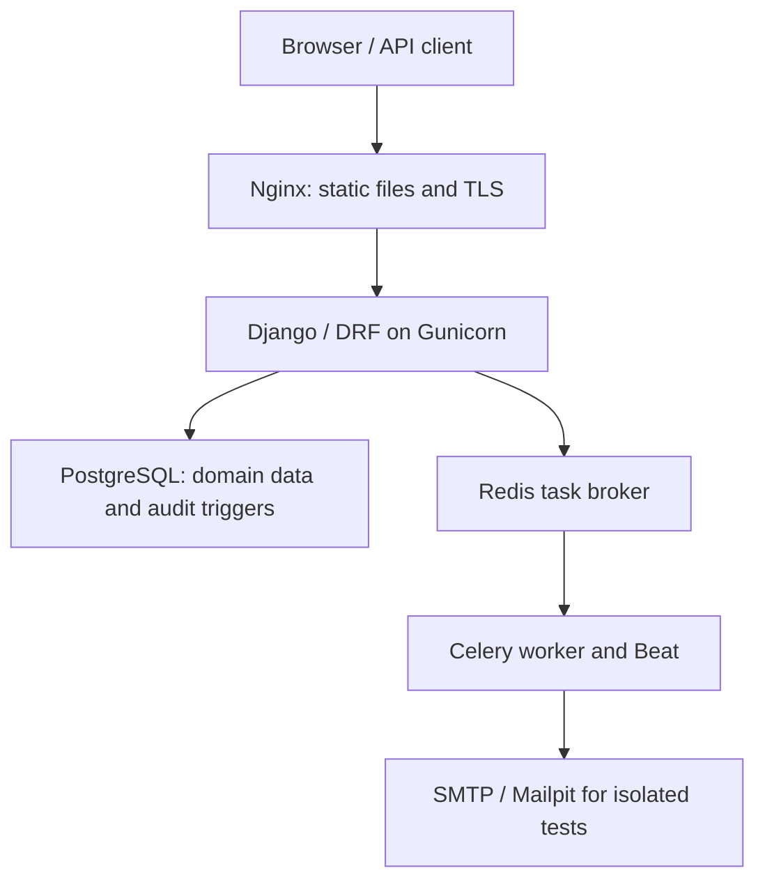

# Student Attendance Management System (SAMS)

Final project report · review edition · 30 October 2026
UE24CS341A Software Engineering · PES University · AIML Section F

## Team and accountability

| Member | SRN | GitHub | Role |
| --- | --- | --- | --- |
| Kundhan Vudutha | PES1UG24AM327 | Kundhan73 | Developer: implementation, integration, fixes and delivery |
| Tarun J | PES1UG24AM304 | DarkTJ7 | Tester: execution, defects and retests |
| Anish | PES1UG24AM348 | planetai05 | QA: requirements, evidence, traceability and release review |

Repository: https://github.com/Kundhan73/SE-MiniProject-SAMS
Project: https://github.com/users/Kundhan73/projects/1

These are accountable roles. Git history and evidence identify actual contributions, including fixes and tests submitted in teammate PRs. Assisted execution is identified in its reports. A task assignment or automated pass does not establish personal review, faculty approval or UAT.

## Problem and scope

SAMS replaces fragmented attendance records with scheduled faculty roll calls, private student views, correction decisions and auditable reports. It implements the submitted Django/DRF architecture as a modular monolith. The local demo uses synthetic identities; it is not a production deployment with real student records.

The baseline SRS defines 21 functional, six non-functional and five security requirements. The complete mapping from requirement to code and automated evidence is in [TRACEABILITY.md](TRACEABILITY.md). Tests support the implemented behaviors; external, human and long-term acceptance remains separately tracked.

## Schedule and evidence dates

| Teacher window | Status as of 30 October |
| --- | --- |
| Sprint 1: 19–23 October | Baseline planning window. The current build and one-minute retrospective were produced later; no original sprint delivery is inferred. |
| Sprint 2: 26–30 October | Implementation, test evidence, bug fixes and integration prepared on 29–30 October. Final peer review and freeze remain gated. |
| Testing / optional Sprint 3: 2–6 November | Planned future validation and closeout window. Preparation checks already executed are dated 29–30 October. |

Earlier Jira sprint dates differ from the teacher's windows. [DEVIATIONS.md](DEVIATIONS.md) explains this and the technical changes. Jira synchronization is paused at the owner's request; GitHub is the current work tracker. Board status must follow reviewed evidence, not a claimed historical sprint completion.

## Architecture

Domain modules are accounts, courses, attendance, reports, notifications and audit. Shared API adapters, permissions and input errors live in core. Diagram sources, revised SRS/SAD/Test Plan PDFs and API documentation are under docs. [API.md](API.md) describes endpoints; the same-origin Swagger UI is available at /api/docs/.

## Implemented behavior

| Area | Behavior and boundaries |
| --- | --- |
| Accounts | Institute-ID authentication, salted production password hashing, five-failure lockout, expiring single-use reset links, idle expiry and logout revocation. |
| Access | Student, Faculty and Admin permissions and record ownership enforced on the server. Project team roles are separate from application roles. |
| Academic setup | Courses, sections, faculty assignment, timetable clash checks and CSV enrollment with row errors. |
| Attendance | Timetable-derived sessions, complete P/A/OD rosters, atomic submission, duplicate rejection and explicit edits with reasons. Submitted views use actual saved marks. |
| Corrections | Student requests routed to responsible faculty; approve/reject decisions and resulting record changes are audited. |
| Reports | Student/course/date filters, strictly-below-threshold defaulters, CSV formula neutralization and paginated PDF export. No held classes is displayed as No classes. |
| Notifications | In-app records, background email, daily deduplication, retry exhaustion and admin-only failure inspection. |
| Audit | Append-only service/API behavior plus SQLite/PostgreSQL triggers rejecting direct mutation. Database-owner privileges remain an operational responsibility. |
| UI | Role dashboards, distinct form labels, focusable named table regions, keyboard scrolling and CSP-compatible local API documentation assets. |
| Operations | Database/Redis health checks, container setup, image delivery configuration and a working-hours probe utility. Installation of external monitoring and scheduled backups is still required. |

## Test strategy and current reports

The automated suite includes service, API/database and workflow checks. SQLite and PostgreSQL are tested in CI. Statement coverage must reach 80% and branch coverage 70%; the report generator enforces both gates.

The current integrated execution counts and percentages are generated from actual XML rather than copied terminal transcripts:

- [Unit and integration report](reports/Unit_Test_Report.md)
- [System Validation Report](reports/System_Validation_Report.md)
- [Code Coverage Report](reports/Code_Coverage_Report.md)
- [Branch Coverage Report](reports/Branch_Coverage_Report.md)
- Raw [JUnit](reports/junit.xml), [coverage XML](reports/coverage.xml) and [summary](reports/summary.json)

Consult each timestamp, source commit and Actions artifact. Reports on separate teammate branches were valid for those branches; merging changes requires a new integrated run. Statement coverage does not measure frontend behavior, deployment configuration, full security assurance or user acceptance.

### Independent and assisted evidence

[Tarun's 29 October report](testing/tarun-2026-10-29/README.md) retains original failures, integrated retests, local Docker/PostgreSQL/Mailpit results, retry/recovery and initial accessibility/security checks.

[His 30 October report](testing/tarun-2026-10-30/README.md) and case register record the exact source for each result: baseline 05ce028 or the PR #50 candidate db0c84c. They include 33 targeted authenticated HTTP checks, a bounded ZAP scan, nine localhost TLS checks with an explicit private CA, and 49 browser/accessibility cases across four browser engines/configurations and two widths. Six supplied Lighthouse snapshots scored 100. Those archived results predate final integration and are not relabeled as a new integrated execution.

The supplied reports explicitly identify Codex-assisted execution. Tarun's personal conclusion, Anish's final review and faculty UAT remain distinct. Physical-device and human assistive-technology checks are not established by browser emulation. Private-CA localhost verification does not establish a publicly deployed HTTPS service.

### Performance evidence and unresolved capacity

| Supplied profile | Source and actual result | Interpretation |
| --- | --- | --- |
| 100 clients, 600 seconds after full spawn | Baseline 05ce028; 34,320 requests, zero failures, 40 attendance submissions, aggregate p95 150 ms | Recorded normal profile met its supplied gate on an isolated Linux budget of two logical CPUs and under 4 GiB. |
| 300 clients, 120 seconds after full spawn | Same baseline; 35,701 requests, zero failures, aggregate p95 3,100 ms | Missed the 3,000 ms latency criterion; capacity acceptance remains open. It reused 100 identities and made no new submissions. |
| Earlier laptop attempts | High latency and incomplete workload, preserved in the 29 October archive | Failures remain evidence; later hosted successes do not erase them. |

The supplied aggregate latency includes ramp traffic. It does not separately quantify latency only at full concurrency. Two synchronous workers and the gap between handler and end-to-end latency suggest queueing; resource saturation was not proven. Any tuning needs a fresh controlled comparison. No production capacity or semester uptime guarantee follows from these runs.

## Defects and integration

| Finding | Change |
| --- | --- |
| #45 | Format a missing PDF percentage as No classes; retain the percent suffix for numeric values. |
| #46 | Separate current backend execution from supplied browser/load artifacts and disclose missing provenance. |
| #47 | Give repeated admin selectors distinct IDs while preserving submitted field names. |
| #49 | Add consistent proxy security headers and remove incompatible inline progress-bar attributes. |
| #51 | Make overflow tables named, keyboard-focusable scrolling regions. |
| #52 | Serve Swagger assets locally and use external initialization under strict CSP. |
| Database health outage | Return a clear 503 when the database probe fails. |
| Integration monitoring review | Avoid passing an unmeasured SLA, validate the health response, preserve corrupt history and support repeated recorded probes. |
| Integration browser review | Require successful role-screen content and reject application/API failures before accessibility auditing. |

Original failures and historical retests are preserved. Developer integration and automated regressions do not replace the final Tester/QA decision.

## CI/CD and release process

Every PR runs SQLite and PostgreSQL tests, lint/format and migration checks, dependency audit, browser workflows, a Docker build/smoke test and a target-scale load check. Required checks summarizes the jobs. Expanded browser/accessibility validation provides additional evidence.

After a peer-reviewed PR merges to main and main CI succeeds, Delivery builds and publishes a SHA-tagged image and latest to GHCR. This is image delivery; no remote deployment is implied. The workflow does not currently request multiple image architectures. Jenkins/Sonar configuration exists, but no external server execution is asserted.

Main requires passing checks and a real peer approval. Anish's approval at 05ce028 covers that earlier commit. The final integrated changes need a new review; no approval is entered on his behalf.

## Maintenance and monitoring

[MAINTENANCE_PLAN.md](MAINTENANCE_PLAN.md) contains corrected backup, restore and explicit-image rollback procedures. The operator must install and rehearse scheduling, encrypted storage, offsite transfer and recovery on a selected host. The RTO of two hours and RPO of 24 hours are objectives, not measured recovery results. Image rollback can involve downtime and cannot undo incompatible database changes.

The probe utility supports repeated recording and a working-hours sample summary. Use a single writer per log outside the repository. No observations produce an unmeasured result. An external supervisor/monitor and alert transport are not installed by the utility; missing observation intervals are not automatically counted as uptime.

## Remaining acceptance and submission work

- Complete the 300-user capacity assessment/tuning and required staging validation.
- Provision a staging host/domain and test email service for public TLS/external delivery checks, or obtain an explicit faculty decision on unavailable resources.
- Obtain actual Tester review, final QA approval and faculty UAT; complete human/device checks required by the test plan.
- Merge only after protected checks and review pass, then verify main CI and Delivery publication.
- Rehearse backup/restore/rollback and collect real monitoring/retention evidence over the required time period.
- Run Jenkins/Sonar if specifically required by the evaluator; otherwise explain the GitHub Actions implementation.
- Confirm the evaluator's exact final-report template, rehearse the 15-minute presentation and complete [SUBMISSION_CHECKLIST.md](SUBMISSION_CHECKLIST.md).

## Sign-off status

Developer integration evidence is recorded in the PR and generated reports. Tester personal acceptance: pending. QA approval of the final integrated commit: pending. Faculty UAT/evaluation: pending. Team names above identify responsibility and are not signatures.
