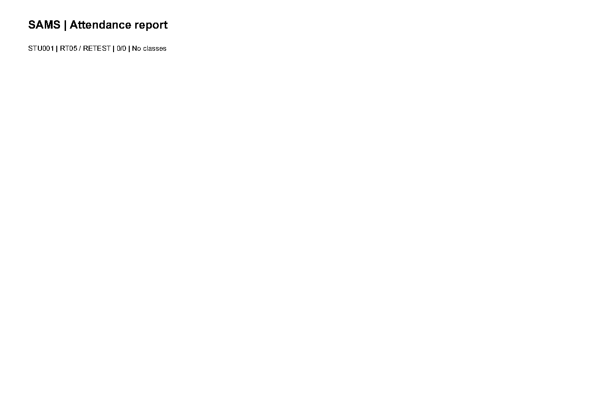
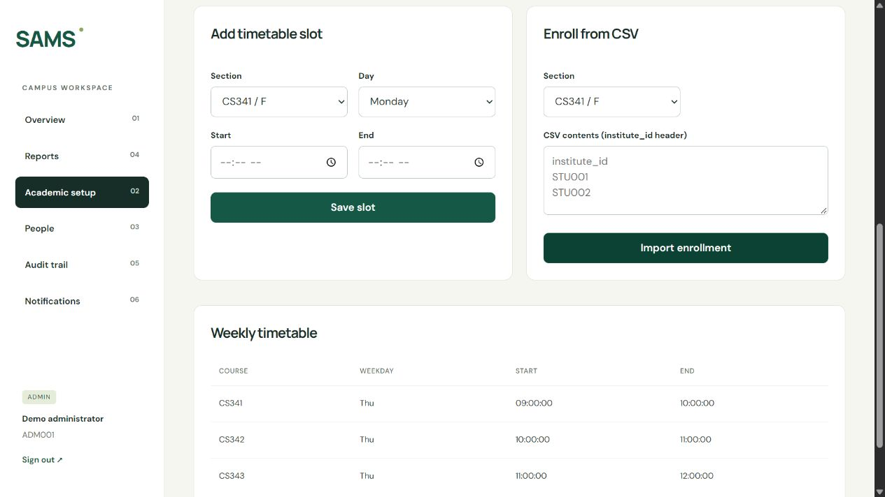
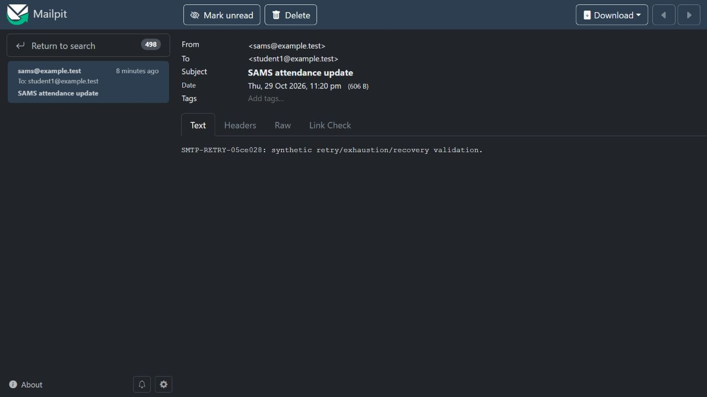
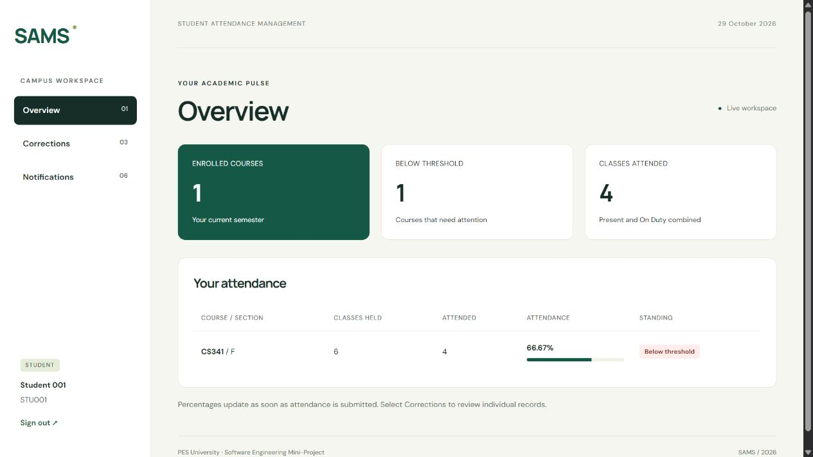
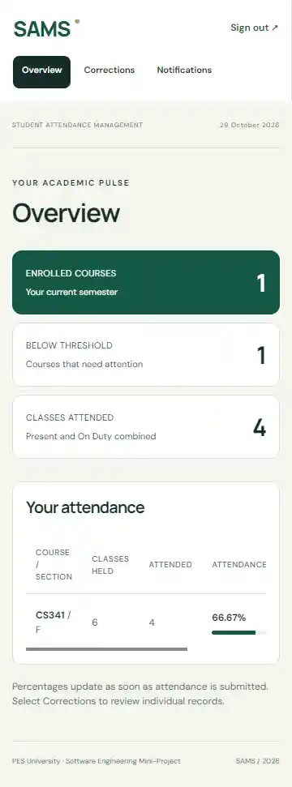

# SAMS integrated-commit retest and local validation

Prepared 2026-10-29T18:06:12.190825+00:00. Executor: Codex-assisted execution on Tarun's laptop, using synthetic test data. This is not Tarun's personal tester conclusion, QA approval or faculty UAT.

Integrated commit: `05ce0282959ab2084b553bcd1e43aa312961d21c`. Accessibility fix: `d79252c88539bbabbd7edbe5afbb4cad925e9937`, local branch `codex/admin-select-labels`.

## Verified results

- Fresh pytest on the integrated commit: **138 passed**, zero failures; statement coverage **99.87%**, branch coverage **97.06%**. Actual output, JUnit, coverage XML and generated reports are in `automated/` and `pytest.txt`.
- Fresh pytest also passed **138 tests** on the combined local fixes `1f62e4708179f738c65008ae63308fc805eb35bc`. Its separate XML/reports are in `automated-local-fixes/` and `pytest-local-fixes.txt`; the earlier integrated-commit artifacts remain unchanged.
- Issues #45 and #46 passed their targeted retests on the actual integrated commit. The original failed executions and local-fix retests remain in the earlier archive.
- New issue #47: duplicate Section/Role IDs reproduced on the integrated commit. Both label associations and both form submissions passed after local fix `d79252c88539bbabbd7edbe5afbb4cad925e9937`. This fix requires developer integration and a subsequent upstream-commit retest.
- New issue #49: proxy CSP/static nosniff/version findings were fixed locally in `1f62e4708179f738c65008ae63308fc805eb35bc`. A strict script/style policy preserves existing Google Fonts origins; numeric attendance widths now use trusted external-script CSSOM updates instead of inline style attributes. Six header checks and actual student/faculty/admin browser rendering passed. Source HTTPS policy was updated, but live HTTPS was not tested.
- Keyboard login focus/Enter check passed. Lighthouse login and authenticated admin overview scored 100. Docker student overview at 360 x 800 scored 100. These are scoped checks, not a full WCAG or cross-browser certification. Setup/People were checked separately and exposed #47. Two expired-session Lighthouse attempts reached login and are retained only as excluded attempts.
- All seven hosted GitHub Actions checks for the integrated commit were verified successful. These are hosted results, separate from this laptop's executions.

## Local environment and load results

No shared staging URL or external mailbox service exists. Docker runs on loopback HTTP at localhost:8000; Mailpit at localhost:8025 captures synthetic email. Fresh random local secrets were created in ignored `.env`; that file and session headers are excluded from publication. Celery's local worker concurrency was limited to two after initial startup exhausted laptop memory and health checks timed out. The first startup failure remains documented.

Seeded environment: `{"captured_at": "2026-10-29T17:23:02.735031+00:00", "commit": "05ce0282959ab2084b553bcd1e43aa312961d21c", "environment": "Tarun laptop, Docker Desktop, Nginx, Gunicorn two workers, PostgreSQL, Redis, Celery and Mailpit; loopback HTTP only", "database_vendor": "postgresql", "students": 2000, "faculty": 100, "courses": 20, "attendance_records": 12000, "notifications": 0, "email_sent": 0, "email_failures": 0, "eager_tasks": false, "email_backend": "django.core.mail.backends.smtp.EmailBackend", "email_host": "mailpit", "production_schedule_seconds": 86400}`

Measured load evidence: `{"load": {"requests": 31, "failures": 0, "p95_ms": 14000.0, "requested_users": 20, "requested_duration_seconds": 40, "has_report_requests": false, "scope": "Tarun laptop, local Docker Nginx/Gunicorn two workers/PostgreSQL, synthetic 2000 students and 100 faculty", "latency_target_met": false, "limitation": "Windows Locust raised a CSV-writer shutdown error; reports endpoint was not reached. Retained as a failed/incomplete run."}, "linux-load": {"requests": 36, "failures": 0, "p95_ms": 20000.0, "requested_users": 20, "requested_duration_seconds": 40, "has_report_requests": false, "scope": "Tarun laptop, local Docker Nginx/Gunicorn two workers/PostgreSQL, synthetic 2000 students and 100 faculty", "latency_target_met": false}}`

The Windows attempt missed the three-second p95 target and did not cover report requests; a Locust shutdown error also occurred. Do not interpret its exit code zero as a validation pass. The Linux retry ran while accelerated notification validation was active and also failed latency/workload coverage. Hosted CI success does not override a local failure. The downloaded hosted artifact was separately reviewed: 412 requests, zero failures, p95 250 ms on the documented hosted PostgreSQL environment (`Hosted-Performance-Reviewed.json`).

## Scheduled notification evidence

Production configuration retains its 86400-second interval. A separate test-only settings module configured a 10-second beat interval. `accelerated-beat-verified.txt` records actual scheduler dispatch, rather than directly calling the task. The initial test configuration did not establish a dispatch and is excluded from scheduler-pass claims. Test beat containers were stopped; normal beat was restored.

Worker/Mailpit snapshot: `{"captured_at": "2026-10-29T17:46:10.518028+00:00", "commit": "05ce0282959ab2084b553bcd1e43aa312961d21c", "environment": "Tarun laptop, Docker Desktop, Nginx, Gunicorn two workers, PostgreSQL, Redis, Celery and Mailpit; loopback HTTP only", "database_vendor": "postgresql", "students": 2000, "faculty": 100, "courses": 20, "attendance_records": 12000, "notifications": 2000, "email_sent": 2000, "email_failures": 0, "eager_tasks": false, "email_backend": "django.core.mail.backends.smtp.EmailBackend", "email_host": "mailpit", "production_schedule_seconds": 86400}`

The completed scan recorded 2000 notifications and 2000 successful SMTP deliveries before the separate retry fixture. Two accelerated dispatches occurred; the redundant second scan was stopped during cleanup, while the first completed. A sample recipient/body was checked in Mailpit. Mailpit's retained inbox is a sample rather than a permanent archive of every delivery. The isolated failure worker used port 1 only on its own test queue: the fixture reached four failed attempts, remained visible in-app, appeared in the admin failure API, and was denied to the student (403). Recovery with normal SMTP succeeded and was verified in Mailpit. Test-only SMTP workers were stopped. The initial API assertion incorrectly searched for message text in an endpoint that returns IDs; the corrected assertion verified the fixture ID. This harness correction is not an application bug fix.

ZAP baseline details and the post-fix scan, when present, are retained in separate files. The baseline JSON includes more informational/header entries than the command's grouped summary. The CSRF cookie warning concerns `csrftoken`, which the external app script reads; it is not proof that authentication cookies lack HttpOnly. Cross-origin embedding policy needs applicability review. The scanner's initial startup timeout and subsequent completed run are distinguishable.

The post-fix ZAP grouped summary is 65 PASS, two WARN groups and zero FAIL-rule hits. The JSON confirms the targeted CSP/version/nosniff/permissions/resource findings are absent; remaining CSRF/embedding and informational entries are retained. This is a local unauthenticated passive scan, not a complete penetration test. Method: https://www.zaproxy.org/docs/docker/baseline-scan/ . CSP style behavior: https://developer.mozilla.org/en-US/docs/Web/HTTP/Reference/Headers/Content-Security-Policy/style-src-attr ; Nginx header inheritance: https://nginx.org/en/docs/http/ngx_http_headers_module.html#add_header .

Real external mailbox delivery and a full-day production timing observation remain pending. Local SMTP and accelerated scheduling do not establish those outcomes.

## Traceability and remaining work

`Retest-Cases.csv` records each new case's expected result, actual result, status, commit and evidence. `Issue-Coverage.json` maps the original MAN cases to assigned issues #37–#42 without claiming they were all rerun on the new commit. Earlier archive: https://github.com/user-attachments/files/34134505/SAMS-Test-Evidence.zip ; original publication: https://github.com/Kundhan73/SE-MiniProject-SAMS/pull/1#issuecomment-6497995970 .

- #29: local performance acceptance remains open if the valid retry misses target; staging performance and uptime observation remain pending.
- #30: #49 has a local tested fix; assess remaining ZAP findings and authenticated coverage. Public certificate/TLS checks require a staging host/domain. No live public TLS validation is claimed.
- #31: #47 needs upstream integration/retest. Full cross-browser and assistive-technology review remain pending beyond the scoped Lighthouse/keyboard/mobile checks.
- #42: local accelerated scheduling, Mailpit delivery, retry exhaustion, admin-only failure logging and recovery were verified. External mailbox delivery and a full-day production schedule observation remain pending.
- Tarun must review evidence and post his own honest tester conclusion. Anish/planetai05 must provide actual QA review. Only faculty may waive required external validation.

Local SQLite audit-login refresh encountered a database-lock 500 under concurrent activity. This is recorded as an environment limitation; successful PostgreSQL checks are not a claim that the SQLite failure was fixed.

## Selected screenshots

These are assisted-execution screenshots. Each case and tested commit is recorded in the archive.

